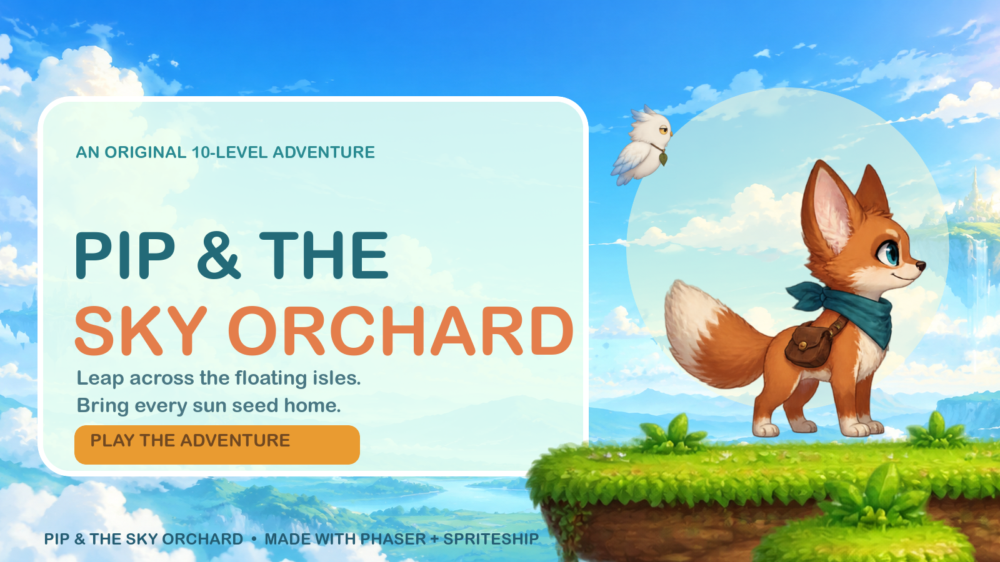
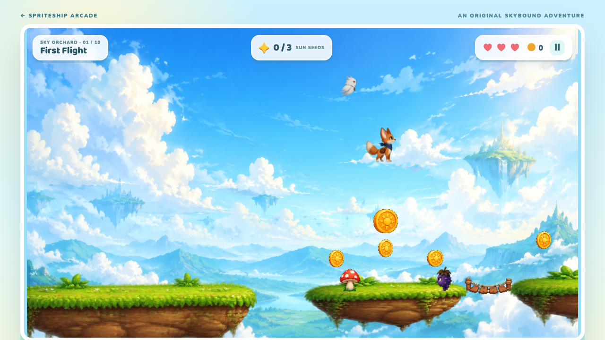
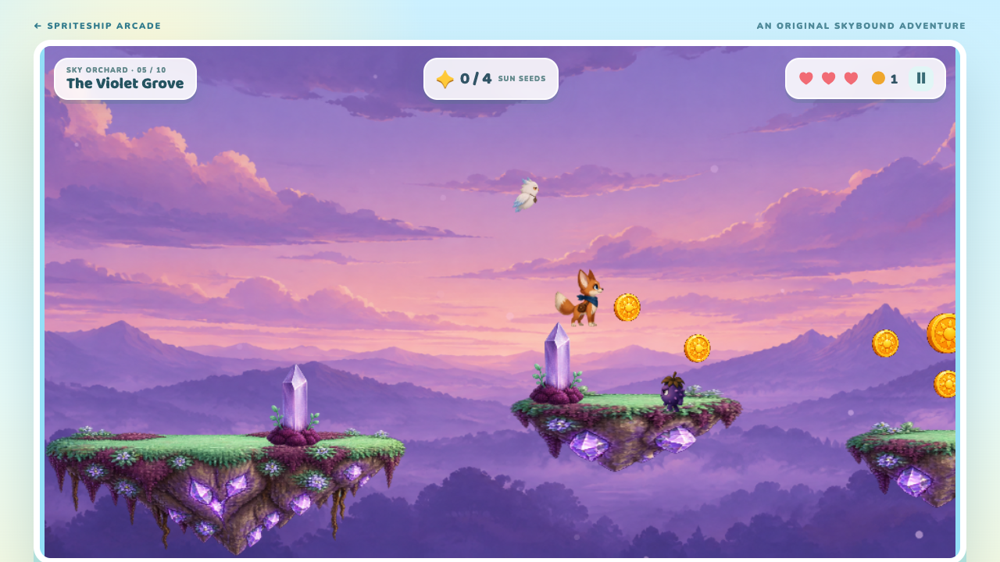
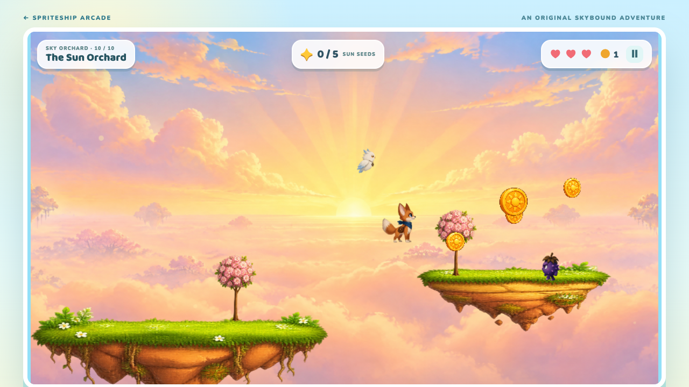

# Pip & the Sky Orchard

A ten-level Phaser 3 platform adventure inspired by the supplied bright floating-island reference. Pip, a fox courier, gathers sun seeds to open each island's gate while Mallow the owl follows and Bramble creatures patrol the route.

**[Play on GitHub Pages](https://spriteship.github.io/sample_games/sky-orchard/)** · [Watch the gameplay preview](media/gameplay.mp4)



## Screenshots

| First Flight | The Violet Grove | The Sun Orchard |
| --- | --- | --- |
|  |  |  |

The [title screen](media/menu.png) and [campaign finale](media/finale.png) are also available. The [cover image](media/cover.png) is assembled from the game's SpriteShip assets by `tools/make-cover.sh` using ImageMagick.

[See all ten level screenshots together](media/ten-worlds.png), or open any image in [`media/levels/`](media/levels/).

## Play

From the repository root:

```bash
npm run dev:sky-orchard
```

Open <http://127.0.0.1:4285>. `npm run build:sky-orchard` copies the self-contained game to `games/sky-orchard/dist/`.

- Move: A/D or left/right arrows
- Jump: Space, W, or up arrow; press again in mid-air for a double jump
- Short taps make short hops; holding jump reaches higher platforms
- Stomp Brambles from above. Three hearts and a mid-level checkpoint help with retries.
- Gather every larger sun seed to open the exit. Small coins raise the run score.
- Touch controls appear on coarse-pointer devices. Progress through unlocked levels is saved locally.

## Campaign

| Level | Landscape | Play twist |
| --- | --- | --- |
| 1. First Flight | Sunny meadow islands | Learn the jumps |
| 2. Mushroom Mile | Rose sky, mushroom-covered earth | Bounce on mushroom caps |
| 3. Breezy Bridges | Turquoise coastal cliffs | Ride a gentle tailwind |
| 4. Honeydrop Heights | Amber sunset and honeycomb rock | Sticky ground slows your run |
| 5. The Violet Grove | Lavender dusk and crystal moss | More Bramble patrols |
| 6. Lantern Ledges | Lantern-lit blue stone | More moving landings |
| 7. Whispering Canopy | Jade treetops and root-bound islands | Longer jumps and thorn patches |
| 8. Thunderberry Run | Storm clouds and slate cliffs | Headwind across wide gaps |
| 9. Cloudbreak Crossing | Cloud sea and frosted stone | Slippery ground and high climbs |
| 10. The Sun Orchard | Golden dawn and flowering earth | The longest route and final gauntlet |

Each level has its own SpriteShip backdrop and three matching island silhouettes. The routes use different opening widths, height rhythms, island sizes, bridges, coin trails, and seed locations; themed landmarks such as wind pennants, honey saplings, lanterns, stormstones, and blossom trees reinforce each world. Routes remain stable across retries. Bramble patrols increase from two in level 1 to nine in level 10; gaps, vertical climbs, moving platforms, and hazards also grow through the campaign.

## Art and credits

All characters, terrain, props, and backdrops were generated for this game in SpriteShip project `proj_1792746064854_ufby`. The selected original cast is Pip (`Pip__a_small_brave_cinnamon_or_1792746179524_cpd5`), Bramble (`Bramble__a_mischievous_round_p_1792746190265_o2uh`), and Mallow (`Mallow__a_tiny_floating_cream_1792746240039_a6wu`). Each later level has a matching distant backdrop and terrain collection, bundled in `public/assets/worlds/`. The first level uses `orchard-sky` and `floating-island-kit`; shared props use `orchard-props`. Animation atlases and manifest data live in `public/assets/animations/`; [SpriteShip's asset license](public/assets/SPRITESHIP-LICENSE.txt) is included.

Net SpriteShip spending for this production was **4,400 credits** of the authorized 20,000, including 1,800 credits for nine new backdrops and nine terrain collections and 800 credits for eight themed landmark collections. A failed Mallow motion job and revised Pip walk attempts were refunded and recovered at zero additional credits. The revised Pip walk has cleaner edges and a more visible gait; the original idle scored better, so it remains in the game. The game makes no SpriteShip API calls at runtime.

## Verification

Run `npm test --workspace @spriteship/sky-orchard` to validate the ten routes, distinct opening silhouettes, enemy counts, art coverage, and jump geometry. Browser play passes covered the first gap of every revised level, hazards, checkpoints, exit locking, all ten level transitions, and all four animation atlases. Bramble patrols stay on all ten levels' islands, a side collision costs one heart, and a stomp defeats the enemy and awards two coins.
